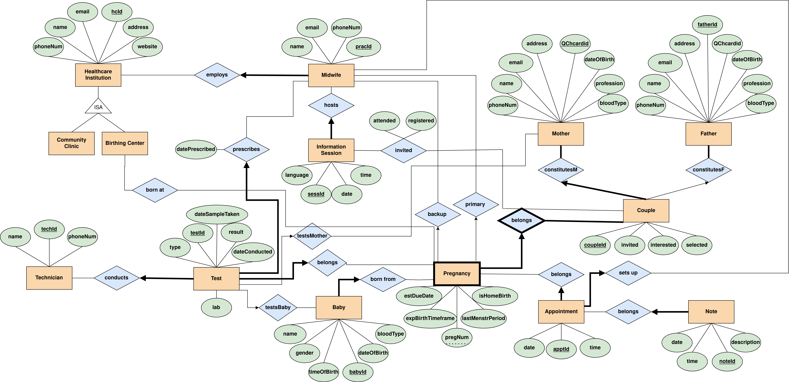

# McGill-COMP421-Project
In this project we developed a database (and associated application) to manage the Midwifery services across the province.

## **Iteration 1**: 
Design a model (ER diagram + relational translation to a Relational Model).  
[Project Report](https://github.com/YazdanZ/McGill-COMP421-Project/blob/master/p1/report/project.pdf) | [ER diagram](https://github.com/YazdanZ/McGill-COMP421-Project/blob/master/p1/ER.pdf) 

---

## **Iteration 2**: 
Created a schema and implemented a database using DB2, populated the database with data, created views, set constraints, maintained, queried and
updated data.  
[Project Report](https://github.com/YazdanZ/McGill-COMP421-Project/blob/master/p2/report/project2.pdf) | [SQL code and run scripts](https://github.com/YazdanZ/McGill-COMP421-Project/tree/master/p2/src) | [Run logs](https://github.com/YazdanZ/McGill-COMP421-Project/tree/master/p2/results)

---

## **Iteration 3**: 
Developed an application program JDBC, and implemented a user-friendly interface in Java. Some extra things like adding an index and exporting and visualizing data from the DB.  
[Project Report](https://github.com/YazdanZ/McGill-COMP421-Project/blob/master/p3/report/project3.pdf) | [Source](https://github.com/YazdanZ/McGill-COMP421-Project/tree/master/p3/src)
